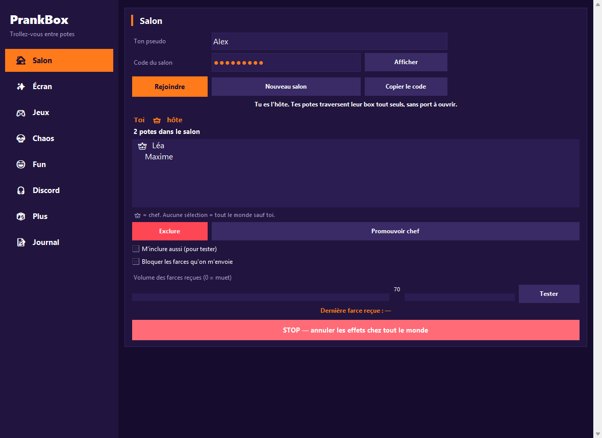
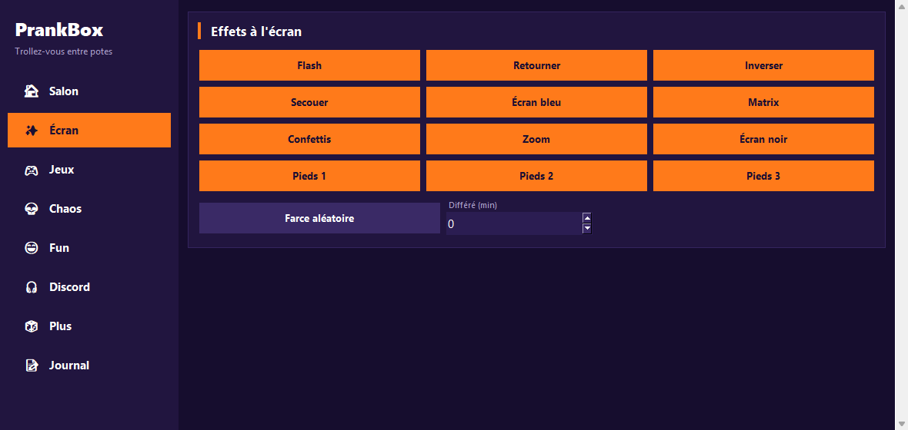
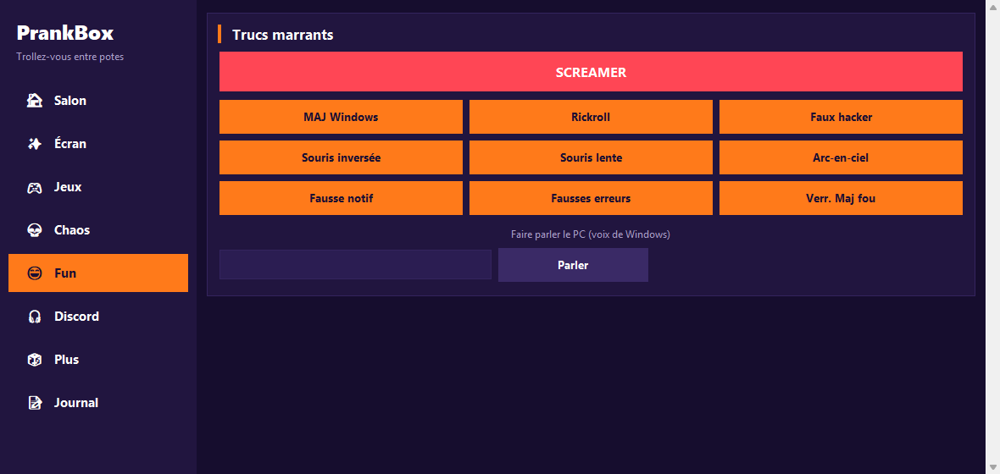

# PrankBox

Farces en réseau entre potes, sur Windows. Tout le monde lance le même programme. Celui qui crée le salon est l'hôte : les farces passent par son PC, et il peut exclure quelqu'un ou promouvoir d'autres chefs. On ne partage que le code du salon. L'adresse du PC n'est jamais affichée ni copiée.

Les farces sont pour des amis qui sont d'accord. La fenêtre reste visible, chacun peut bloquer ce qu'on lui envoie, et un raccourci arrête les effets reçus.



## Installer Python

PrankBox a besoin de Python, avec Tkinter (l'interface). Rien d'autre à installer : pas de `pip`.

1. Ouvre [python.org/downloads/windows](https://www.python.org/downloads/windows/) et prends l'installateur **Windows installer (64-bit)** de Python 3.10 ou plus récent.
2. Au premier écran, coche **Add python.exe to PATH**.
3. Clique sur **Install Now**. Tcl/Tk, qui affiche la fenêtre, est inclus.

Vérifie dans un terminal :

```bat
python --version
```

Si Windows répond que `python` est introuvable, utilise le lanceur à la place : `py --version`.

## Installer PrankBox

1. Sur cette page GitHub, clique sur **Code**, puis **Download ZIP**.
2. Dézippe le dossier, par exemple dans `Téléchargements\prankbox`.
3. Ouvre un terminal dans ce dossier. Dans l'explorateur : clique la barre d'adresse, tape `cmd`, puis Entrée.
4. Lance :

```bat
python prankbox.py
```

Si `python` n'est pas reconnu :

```bat
py prankbox.py
```

Au lancement, PrankBox regarde GitHub et se met à jour tout seul. La mise à jour est signée : un fichier modifié sur le dépôt sans cette signature n'est pas installé.

Si Windows demande d'autoriser Python à communiquer sur le réseau, accepte. Sinon tes potes ne pourront pas rejoindre le salon.

## Créer un salon

1. Écris ton pseudo.
2. Clique sur **Nouveau salon**.
3. Clique sur **Copier le code** et envoie seulement ce code (`XXXX-XXXX`) à tes potes, par Discord ou comme tu veux.
4. Laisse PrankBox ouvert. Tu es l'hôte : si tu quittes, le salon se ferme.

Le code est masqué par des points, pour ne pas le montrer en stream. **Afficher** le révèle pendant dix secondes. Le texte copié ne contient que le code, jamais l'adresse de ton PC.

## Rejoindre un salon

1. Lance le même programme.
2. Écris ton pseudo et colle le code reçu.
3. Clique sur **Rejoindre**.

Sur le même Wi-Fi, les PC se trouvent tout seuls. Par Internet aussi, sans ouvrir un port sur la box. Certaines connexions très fermées (une partie des 4G) n'y arrivent pas : dans ce cas, mettez-vous sur le même réseau.

L'hôte doit garder PrankBox ouvert. S'il a fermé le programme, le message « Hôte introuvable » s'affiche : demande-lui de le relancer, le code reste le même.

Tout le monde dans le salon doit avoir la même version. Le numéro est écrit sous le titre, dans la barre de gauche. Si ce n'est pas le cas, la connexion est refusée : relance PrankBox, la mise à jour part toute seule.

## Chefs et membres

Une couronne à côté du pseudo marque un chef. L'hôte en est un. Dans la liste :

- **Exclure** retire la personne pour cette session. Elle ne peut plus revenir avec le même pseudo tant que le salon est ouvert.
- **Promouvoir chef** donne le droit d'exclure des membres, d'en promouvoir d'autres et de régler le délai entre deux farces.
- **Retirer chef** enlève la couronne. Seul l'hôte peut le faire.

Un chef promu ne peut pas exclure l'hôte, ni un autre chef. Promouvoir quelqu'un ne déplace pas le salon : le trafic reste sur le PC de celui qui l'a créé.

**Délai entre deux farces** : l'hôte et les chefs choisissent un nombre de secondes (0 à 120) et cliquent sur **Appliquer**. `0` enlève la limite. Chacun doit attendre ce délai avant d'envoyer la farce suivante. **STOP** part tout de suite.

## Envoyer une farce

Les pages de la barre latérale regroupent les farces : Écran, Jeux, Chaos, Fun, Discord, Plus. Le Journal garde l'historique.





- Aucun pseudo sélectionné : la farce part chez tout le monde sauf toi.
- Un ou plusieurs pseudos sélectionnés : elle ne part que chez eux.
- **M'inclure aussi (pour tester)** joue la farce sur ton PC en même temps.
- **Bloquer les farces qu'on m'envoie** ignore ce que tu reçois. Le bouton STOP passe quand même.
- **Différé (min)** attend le nombre de minutes indiqué avant d'envoyer. Le délai entre deux farces s'applique au moment de l'envoi.
- **Volume des farces reçues** règle le son chez toi. `0` coupe le son. **Tester** joue un bip.
- **STOP** annule les effets en cours chez tout le monde.

Sur le PC qui reçoit une farce, le raccourci **Ctrl+Alt+Maj+X** arrête les effets en cours.

## Si ça ne démarre pas

| Ce que tu vois | Quoi faire |
| --- | --- |
| `python` n'est pas reconnu | Relance l'installateur Python et coche **Add python.exe to PATH**, ou lance `py prankbox.py`. |
| `No module named tkinter` | Réinstalle Python depuis python.org avec **Install Now**. L'application du Microsoft Store omet parfois Tkinter. |
| Hôte introuvable | L'hôte doit avoir PrankBox ouvert, avec le même code. Autorise Python dans le pare-feu si Windows l'a demandé. |
| La fenêtre est trop étroite | Sous 860 pixels de large, la barre passe en haut sous forme d'icônes. Élargis la fenêtre pour retrouver les noms des pages. |
